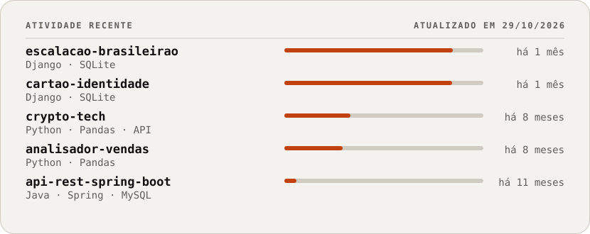

<h1 align="center">
  <picture>
    <source media="(prefers-color-scheme: dark)" srcset="assets/hero-dark.svg">
    
  </picture>
</h1>

**Estudante de Sistemas de Informação na FEPI (Itajubá/MG) e estagiário de desenvolvimento full stack.** Trabalho com software, automação, dados e IA aplicada: construo sistemas e fluxos que transformam dados em informação que alguém consegue usar.

[LinkedIn](https://www.linkedin.com/in/rafael-junqueira-0228b52b3/) · [E-mail](mailto:Rafaeljs08@hotmail.com) · [Instagram](https://instagram.com/rafaelljunqueira) · [Projetos](#projetos-selecionados)

## Agora

- **Estagiando** como desenvolvedor full stack na Support Informática, em sistemas web para a área da saúde
- **Aprofundando:** LangChain, arquiteturas RAG e automação de fluxos com n8n
- **Cursando:** Sistemas de Informação na FEPI

## Experiência

**Estagiário de Desenvolvimento Full Stack** · Support Informática · 03/2026 – atual

Desenvolvimento, manutenção e aprimoramento de sistemas web para gestão hospitalar e clínica, no Sul de Minas Gerais.

- Desenvolvimento e manutenção (corretiva e evolutiva) de aplicações web com PHP e JavaScript
- Administração de bancos MySQL: consultas SQL complexas, stored procedures e functions
- Implementação e consumo de APIs RESTful para integração entre plataformas hospitalares
- Automação de processos internos e construção de relatórios operacionais (BI)
- Suporte técnico e troubleshooting em ambiente corporativo de saúde

## Projetos selecionados

| Projeto | Problema → solução | Stack |
|---|---|---|
| [analisador-vendas-marketing](https://github.com/rafaeljs08/analisador-vendas-marketing) | Pequenos varejos têm vendas em planilha, mas sem BI. Envia-se um CSV e recebe-se KPIs, ranking de produtos e sugestões de marketing | Python · Pandas · Streamlit · IA |
| [crypto-tech](https://github.com/rafaeljs08/crypto-tech) | Acompanhar e comparar criptomoedas em tempo real, em USD ou BRL, com histórico de até 365 dias | Python · Streamlit · Pandas · Matplotlib · CoinGecko |
| [escalacao-brasileirao](https://github.com/rafaeljs08/escalacao-brasileirao) | Montar um time com jogadores de qualquer clube da Série A em um campo interativo, com CRUD completo e validação por formação | Django · SQLite |
| [cartao-identidade-academica](https://github.com/rafaeljs08/cartao-identidade-academica) | Cartão digital de aluno (nome, curso e bio) com galeria e painel administrativo | Django · SQLite |
| [api-rest-spring-boot](https://github.com/rafaeljs08/api-rest-spring-boot) | API REST acadêmica com persistência relacional | Java · Spring Boot · MySQL |

<picture>
  <source media="(prefers-color-scheme: dark)" srcset="assets/status-dark.svg">
  
</picture>

## Stack

- **Linguagens:** Python, PHP, JavaScript, Java (básico)
- **Dados:** Pandas, Matplotlib, Streamlit, SQL avançado (procedures e functions)
- **Web e APIs:** Django, Spring Boot, HTML/CSS, APIs REST
- **IA e automação:** LangChain, RAG, n8n, Copilot Studio
- **Bancos e ferramentas:** MySQL, SQLite, Git, GitHub

## Formação e cursos

**Sistemas de Informação** · Centro Universitário de Itajubá (FEPI) · 2024 – 2027

**Cursos (Alura):** Arquiteturas RAG com LLMs, embeddings, busca semântica e agentes com LangChain · Automação de fluxos integrando n8n e IA · Copilot Studio: soluções multiagentes · Fundamentos de IA · Python e Inteligência Artificial aplicada · Análise de dados · Pensamento computacional

**Idiomas:** português (nativo), inglês (intermediário)

## Contato

[LinkedIn](https://www.linkedin.com/in/rafael-junqueira-0228b52b3/) · [E-mail](mailto:Rafaeljs08@hotmail.com) · [Instagram @rafaelljunqueira](https://instagram.com/rafaelljunqueira) · Itajubá, MG

O painel de atividade é gerado semanalmente por um workflow do próprio repositório (`scripts/build.py`).
